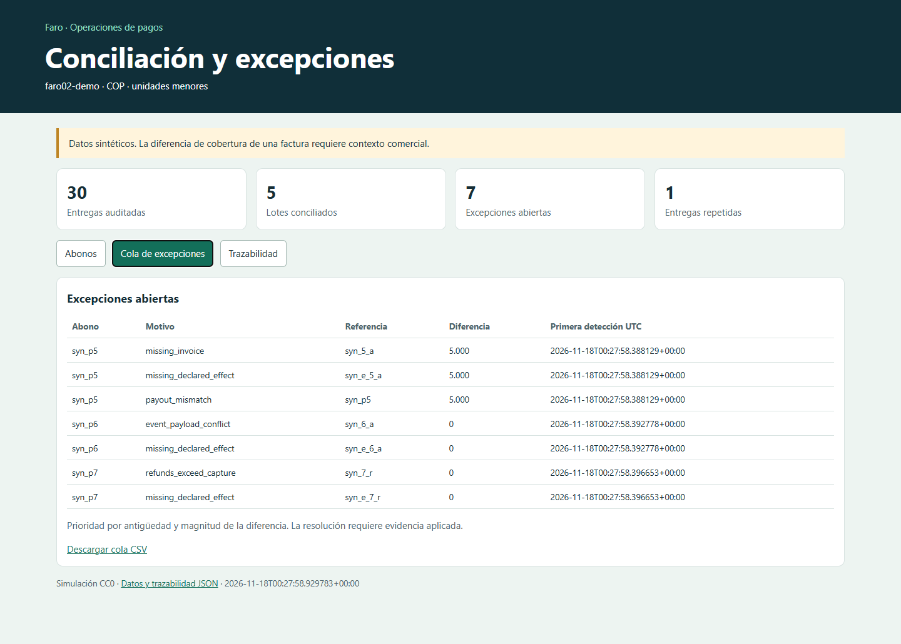

# Payment reconciliation

**Data Engineering** · Simulated payments in Colombian pesos (COP) · [Español](README.es.md) · [Portfolio](https://github.com/jorgealarcon07#projects)

   

## Which processor payouts match the payments?

I built a reconciliation pipeline for a fictional treasury team. It matches processor payouts to payment captures, refunds and fees. Analysts can see which batches are ready to close, which need more information and which require investigation.

**Measured result.** In a test with 100,000 simulated event deliveries, the pipeline identified all 325 payout batches with deliberately introduced discrepancies. None was marked as reconciled.

[Case study](CASE_STUDY.md) · [Open interactive report (Spanish)](https://jorgealarcon07.github.io/jorgealarcon07/conciliacion-de-pagos/) · [Architecture (Spanish)](docs/ARQUITECTURA.md)



## How it works

Python consumes a paginated HTTP feed and writes every delivery to PostgreSQL. The pipeline distinguishes repeated messages from distinct financial events, records corrections and saves its resume cursor in the same transaction as the financial effects. A file replay provides an independent check of the resulting projection.

[Benchmark and test conditions (Spanish)](docs/RESULTADOS.md) · [Pilot exceptions CSV](reports/demo/exceptions.csv) · [Source and licensing notes (Spanish)](DATA_SOURCES.md) · [CI runs](https://github.com/jorgealarcon07/faro-reconciliation/actions)

## Run the pilot

From the repository root, use Python 3.12 and a running PostgreSQL 17 database. Configure the connection using [.env.example](.env.example). The commands below use PowerShell. On Linux or macOS, activate the environment with `. .venv/bin/activate`.

```powershell
python -m venv .venv
.\.venv\Scripts\Activate.ps1
python -m pip install -r requirements.lock
python -m pip install --no-deps --no-build-isolation -e .
python -m pip check
faro-reconcile init-db
faro-reconcile demo --output local/pilot
```

Open `local/pilot/index.html` to review the pilot. The [full guide in Spanish](README.es.md) also covers the isolated PostgreSQL runner, the larger test, HTTP ingestion and recovery.
