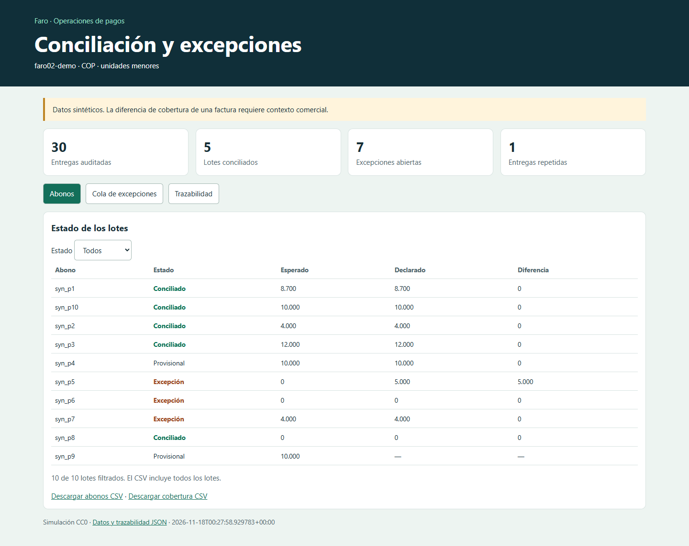

# Faro · Payment Reconciliation

**Project 02 · Data Engineering.** A local reconciliation pipeline ingests paginated synthetic payment deliveries into PostgreSQL, deduplicates economic effects and records why each payout can close. Its review queue and audit trail preserve late arrivals, conflicting variants and corrections.

Faro es una empresa ficticia del portafolio. El piloto usa datos sintéticos en COP y licencia CC0. Los resultados miden integridad y operación del laboratorio. [Fuentes y procedencia](DATA_SOURCES.md).



- [Caso de estudio](CASO_DE_ESTUDIO.md)
- [Reporte HTML y exportaciones del piloto](reports/demo/index.html)
- [Arquitectura](docs/ARQUITECTURA.md) y [contratos](docs/CONTRATOS.md)
- [Resultados y límites](docs/RESULTADOS.md), [JUnit](reports/tests.xml) y [cumplimiento](docs/CUMPLIMIENTO.md)
- [Operación y recuperación](docs/RUNBOOK.md)

## Ejecutar en un entorno aislado

Python 3.12 y PostgreSQL 17. En Windows, usar una ruta de instalación corta. Los comandos de instalación deben correr desde el directorio de este repositorio.

```powershell
python -m venv .venv
.venv/Scripts/python -m pip install -r requirements.lock
.venv/Scripts/python -m pip install --no-deps --no-build-isolation -e .
.venv/Scripts/python -m pip check
.venv/Scripts/Activate.ps1
```

En Linux, activar con `. .venv/bin/activate`. Si PowerShell restringe la activación, usar el ejecutable Python del entorno explícitamente y `python -m faro_reconciliation.cli` en lugar de `faro-reconcile`.

Con binarios PostgreSQL instalados o portátiles, la ruta nativa corre la suite, el piloto y las tres cargas de 1.000 facturas. `--scale` añade el ensayo de 100.000 entregas.

```powershell
python scripts/verify_native.py --bin "C:/ruta/postgresql/bin" --output local/verification --scale
```

En este workspace se probaron los binarios PostgreSQL 17.12 del paquete de desarrollo Zonky conservados en `../../work/runtime/postgres/bin`, con el clúster separado dentro de P02. El runner detiene su servidor al terminar. Los archivos HTML se pueden abrir sin el servidor. [PostgreSQL para Windows](https://www.postgresql.org/download/windows/) · [Zonky](https://github.com/zonkyio/embedded-postgres-binaries).

## Operar con una base accesible

Configurar variables según `.env.example` o crear un `.env` ignorado por Git. Iniciar la base del proyecto antes de los siguientes comandos.

```powershell
faro-reconcile init-db
faro-reconcile demo --output local/pilot
faro-reconcile validate --case ID_DEL_MANIFIESTO
faro-reconcile ingest --case archivo --source data/fixtures --page-size 4
faro-reconcile payout --case archivo syn_p1
faro-reconcile invoice --case archivo syn_i1
faro-reconcile queue --case archivo
faro-reconcile report --case archivo --output local/report --focus syn_p1
```

El piloto usa HTTP local con fallos 429 y 500, deja un reembolso pendiente, registra una diferencia de −100, bloquea un intento de resolución prematuro y aplica una corrección declarada. Evalúa interrupciones antes y después del commit. El manifiesto compara la proyección final con una reconstrucción por archivo. `validate` comprueba el oráculo manual del fixture de diez lotes.

Para arrancar el simulador por separado y cargar su feed, usar dos terminales del mismo entorno con conexión por loopback.

```powershell
faro-reconcile serve --source data/fixtures --port 8082 --faults
faro-reconcile ingest --case http --source data/fixtures --url http://127.0.0.1:8082 --page-size 4
faro-reconcile generate --profile mixed --count 1000 --seed 2026 --output local/bulk
```

`--until N` limita la ingestión a las primeras N posiciones. Esto permite revisar un cursor intermedio y retomar después. Las correcciones se añaden por archivo JSONL independiente. [Runbook](docs/RUNBOOK.md).

## Verificar

```powershell
ruff check .
ruff format --check .
pytest -q -m "not integration"
pytest -q --junitxml=local/tests.xml
```

Las pruebas de integración requieren PostgreSQL. GitHub Actions tiene un servicio PostgreSQL y ejecuta la demo. Compose y CI remoto requieren un entorno que los ejecute. El motor transaccional, HTTP, archivos, recuperación y reporte se verificaron localmente.

Para regenerar las capturas, instalar Playwright 1.65.2 y Chromium en un entorno de revisión, o pasar `--browser` con un ejecutable Chromium instalado. `python scripts/capture_report.py --report reports/demo/index.html --output assets/web`.

## Límites

La simulación trabaja en una moneda, un procesador y referencias dentro del mismo lote. El reporte de factura mide cobertura, que requiere información comercial adicional para determinar un cobro exigible. Las mediciones no estiman beneficios en una operación real. Integración opcional con P01, disputas, impuestos, FX, recepción externa y despliegue productivo quedan fuera de este mínimo.
