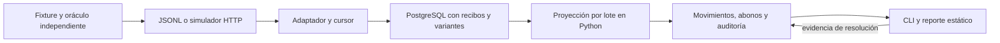

# Arquitectura

`contracts.py` valida la versión, los identificadores y las unidades. `fixtures.py` produce el bundle. `transport.py` sirve o lee páginas y decide cuándo reintentar. `domain.py` calcula un lote a partir de sus eventos válidos. `store.py` controla persistencia, bloqueo por caso y auditoría. `report.py` consulta una instantánea y exporta. Este diseño prueba las reglas puras por separado y reutiliza el dominio con ambas entradas.

## Consistencia de página y revisión

Cada transacción inserta recepciones, añade variantes de evento, recalcula lotes afectados, sustituye su proyección, registra transiciones y actualiza el cursor. La proyección de movimientos es reemplazable. Las recepciones, variantes y auditoría se añaden al historial, y las revisiones de declaración referencian su predecesor.

La unicidad por caso y posición evita reinsertar una página confirmada. Dos posiciones distintas preservan el mismo evento como dos recepciones. La clave de evento identifica variantes de un mensaje y la clave de efecto controla el dinero. Se excluye `received_at` al comparar un cuerpo reenviado, y se excluyen los metadatos de evento al comparar el efecto económico. Elegir el identificador menor entre alias semánticamente iguales hace reproducible la proyección. Una variante incompatible o un efecto asignado a dos lotes bloquea las proyecciones afectadas. Un registro inválido que no puede asociarse a un lote bloquea la revisión del caso completo.

El bloqueo transaccional serializa escritores dentro de un caso. Casos distintos pueden utilizar la misma base de desarrollo. El lector del reporte usa una instantánea consistente. El efecto único verificado es una propiedad del modelo de entrada y de esta base. El laboratorio no mide disponibilidad de un procesador externo ni entrega de extremo a extremo bajo una partición de red.

## Regla de cierre

Un cierre requiere la última declaración final de una cadena lineal explícita, diferencia monetaria cero y coincidencia exacta de los identificadores de efecto declarados y aplicados. Esto evita cerrar por suma cero cuando todavía faltan movimientos que se compensan. Las listas de efectos proceden del contrato de simulación. Un conector a un procesador real necesitaría establecer qué evidencia de completitud proporciona su interfaz.

Las devoluciones enlazan una captura y sus acumulados activos no pueden superar la captura. La reversión compensa íntegramente una captura, devolución o comisión y referencia el efecto original. La reversión de una captura con devoluciones activas se bloquea. El modelo mantiene todas estas dependencias dentro del mismo lote y deja los casos entre liquidaciones como una extensión.

Una factura o un lote recibido más tarde se puede registrar de forma explícita. La operación conserva las referencias previas, registra el alta y reprocesa sus lotes afectados. La cobertura de factura distingue cobertura parcial, total, exceso y ausencia de cobro mediante el importe neto observado.

La revisión humana añade una decisión con autor, motivo y efecto aplicado o declaración vigente. El comando exige que la excepción haya ocurrido y que el lote ya cumpla las invariantes. Anotar evidencia nunca modifica el total.

## Costos y límites

Se recalculan lotes afectados, no todo el caso, y se usan índices por lote, evento y efecto. Se conserva una auditoría creciente. Existe un único escritor por caso para simplificar la integridad. La base de laboratorio usa un rol propietario local. Un servicio para terceros requeriría separar privilegios, autenticar a operadores y definir retención y recuperación con su infraestructura. No hay llamadas a servicios financieros ni infraestructura pagada.
